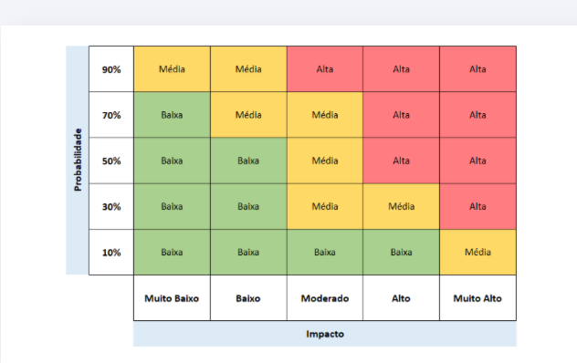

# UNIVERSIDADE ESTADUAL DA PARAÍBA - UEPB
## CENTRO DE CIÊNCIAS E TECNOLOGIA - CCT
### DEPARTAMENTO DE COMPUTAÇÃO
**Disciplina:** Laboratório de Engenharia de Software I  
**Professora:** Rebeca Barbosa Lourenço  
**Período Letivo:** 2026.2  

---

# ATIVIDADE PRÁTICA: GERENCIAMENTO E ANÁLISE DE RISCOS DE SOFTWARE

**Identificação da Equipe:**
- **Equipe / Código:** [ Ex.: E1, E2, E3, E4 ou E5 ]
- **Nome do Projeto:** [ Nome do projeto de software desenvolvido pela equipe ]
- **Integrantes da Equipe:**
  1. [ Nome do integrante 1 - Papel ]
  2. [ Nome do integrante 2 - Papel ]
  3. [ Nome do integrante 3 - Papel ]
  4. [ Nome do integrante 4 - Papel ]
  5. [ Nome do integrante 5 - Papel ]
- **Data de Realização:** [ DD/MM/AAAA ]

---

## 1. Contextualização da Atividade

Os alunos possuem um projeto acadêmico de software com prazo aproximado de um mês para desenvolvimento. Atualmente, possuem apenas o protótipo da aplicação e os artefatos de planejamento produzidos nas etapas anteriores da disciplina.

**Nenhuma funcionalidade foi implementada até o momento.**

A atividade deverá ser realizada antes da implementação, com o objetivo de antecipar possíveis dificuldades técnicas e operacionais e estabelecer estratégias preventivas.

> **Importante:** Não solicite métricas de execução, resultados de testes, análise de código, histórico de bugs ou medições de desempenho. O foco exclusivo desta etapa é a reflexão preventiva e o planejamento prévio.

---

## 2. Identificação dos Riscos

Os alunos deverão identificar os riscos considerando as informações concretas disponíveis nesta etapa do projeto:

- Protótipo da aplicação;
- Requisitos do software;
- Backlog do produto;
- Complexidade das funcionalidades previstas;
- Tecnologias e frameworks escolhidos ou planejados;
- Conhecimento técnico dos integrantes;
- Disponibilidade da equipe;
- Prazo de desenvolvimento;
- Dependências entre funcionalidades;
- Necessidade de integração com serviços externos.

Os riscos deverão representar **eventos incertos que poderão acontecer durante a futura implementação**.

---

## 3. Mensuração da Probabilidade

A probabilidade deverá ser estimada com base nas condições atuais do projeto e nas dificuldades previstas pela equipe antes do início da codificação.

Utilize a seguinte tabela como referência:

| Probabilidade | Classificação | Critério de Avaliação Antes da Implementação |
| :---: | :---: | :--- |
| **10%** | Muito baixa | Não foram identificados fatores relevantes que favoreçam a ocorrência do risco. A equipe possui conhecimento e recursos adequados. |
| **30%** | Baixa | Existem poucas dificuldades previstas, e a equipe possui condições para lidar com elas. |
| **50%** | Moderada | Existem incertezas sobre a implementação, a tecnologia ou a capacidade da equipe de realizar determinada funcionalidade. |
| **70%** | Alta | Existem limitações relevantes, como pouca experiência técnica, funcionalidades complexas ou dependências externas importantes. |
| **90%** | Muito alta | Existem fortes indícios de que o risco poderá ocorrer, considerando as limitações conhecidas e a ausência de alternativas ou medidas preventivas adequadas. |

Os percentuais representam **estimativas qualitativas** utilizadas para padronizar a avaliação. Não representam probabilidades comprovadas estatisticamente.

A equipe deverá justificar a classificação com base nas informações disponíveis antes da implementação.

---

## 4. Mensuração do Impacto

O impacto deverá ser avaliado considerando as consequências previstas caso o risco aconteça durante o desenvolvimento.

Utilize os seguintes critérios:

| Impacto | Critério de Avaliação Antes da Implementação |
| :---: | :--- |
| **Muito baixo** | Poderá exigir pequenos ajustes, sem comprometer as funcionalidades previstas ou o planejamento do projeto. |
| **Baixo** | Poderá exigir alterações pontuais em funcionalidades secundárias, sem comprometer os objetivos principais. |
| **Moderado** | Poderá exigir mudanças no planejamento, retrabalho ou alterações em funcionalidades importantes. |
| **Alto** | Poderá comprometer funcionalidades essenciais, exigir mudanças técnicas significativas ou prejudicar o prazo de entrega. |
| **Muito alto** | Poderá inviabilizar a implementação da proposta, comprometer os objetivos principais ou impedir a entrega de um software funcional. |

### Fatores para Avaliação do Impacto:
Para avaliar o impacto, os alunos deverão considerar:
- A importância da funcionalidade afetada;
- A dependência de outras funcionalidades;
- A existência de soluções alternativas;
- A dificuldade prevista para resolver o problema;
- As consequências para o planejamento;
- O comprometimento do prazo de entrega;
- A viabilidade do projeto.

**Atenção:** Não estabeleça quantidades obrigatórias de horas ou dias de retrabalho, pois o software ainda não foi implementado.

Caso um risco apresente diferentes consequências, considere o **maior impacto aplicável**, desde que devidamente justificado.

---

## 5. Matriz de Probabilidade e Impacto (5 x 5)

A classificação de cada risco é obtida pelo cruzamento da linha da **Probabilidade** com a coluna do **Impacto**, resultando em três níveis: **Baixo** (verde), **Médio** (amarelo) e **Alto** (vermelho).

### 5.1. Imagem Oficial de Referência da Matriz

---

### 5.2. Versão Editável da Matriz para Preenchimento

Insira os códigos dos riscos identificados (**R1, R2, R3, R4, R5...**) no espaço correspondente dentro de cada célula.

| Probabilidade / Impacto | Muito baixo | Baixo | Moderado | Alto | Muito alto |
| :---: | :---: | :---: | :---: | :---: | :---: |
| **90%** | **Médio**  *(inserir códigos)* | **Médio**  *(inserir códigos)* | **Alto**  *(inserir códigos)* | **Alto**  *(inserir códigos)* | **Alto**  *(inserir códigos)* |
| **70%** | **Baixo**  *(inserir códigos)* | **Médio**  *(inserir códigos)* | **Médio**  *(inserir códigos)* | **Alto**  *(inserir códigos)* | **Alto**  *(inserir códigos)* |
| **50%** | **Baixo**  *(inserir códigos)* | **Baixo**  *(inserir códigos)* | **Médio**  *(inserir códigos)* | **Alto**  *(inserir códigos)* | **Alto**  *(inserir códigos)* |
| **30%** | **Baixo**  *(inserir códigos)* | **Baixo**  *(inserir códigos)* | **Médio**  *(inserir códigos)* | **Médio**  *(inserir códigos)* | **Alto**  *(inserir códigos)* |
| **10%** | **Baixo**  *(inserir códigos)* | **Baixo**  *(inserir códigos)* | **Baixo**  *(inserir códigos)* | **Baixo**  *(inserir códigos)* | **Médio**  *(inserir códigos)* |

**Distribuição das Cores:**
- **Verde (#A9D18E):** Riscos Baixos.
- **Amarelo (#FFD966):** Riscos Médios.
- **Vermelho (#FF7C80):** Riscos Altos.

---

## 6. Funcionamento da Matriz

A **probabilidade** representa a possibilidade de ocorrência, enquanto o **impacto** representa a consequência prevista caso o risco venha a se concretizar.

O **nível de risco** é obtido pelo cruzamento dessas duas informações.

Nem todas as linhas apresentam os três níveis de risco, pois a distribuição das classificações foi previamente estabelecida pela matriz de acordo com critérios de severidade.

**Importante:** Os alunos não deverão escolher diretamente o nível de risco. Eles devem estimar a probabilidade, avaliar o impacto e consultar a matriz para verificar a classificação correspondente.

### Exemplo Didático:

- **Risco:** Dificuldade na implementação da autenticação de usuários.
- **Justificativa da probabilidade:** A equipe possui pouca experiência com mecanismos de autenticação.
- **Probabilidade:** 70%.
- **Justificativa do impacto:** A autenticação é necessária para acessar funcionalidades essenciais previstas no protótipo.
- **Impacto:** Alto.
- **Nível de risco:** Alto, conforme a matriz.
- **Estratégia de tratamento:** Estudar previamente a tecnologia escolhida e planejar a implementação da autenticação como uma das primeiras tarefas do desenvolvimento.

*(Observação: esse exemplo é estritamente hipotético e não representa uma funcionalidade já implementada.)*

---

## 7. Registro dos Riscos

Cada equipe deverá identificar, no mínimo, **cinco riscos (R1 a R5)** relacionados ao seu próprio projeto de software. Caso identifique outros riscos relevantes, podem ser adicionadas novas linhas.

| ID | Risco | Causa | Consequência Prevista | Probabilidade | Impacto | Nível de Risco | Ação Planejada | Responsável |
| :---: | :--- | :--- | :--- | :---: | :---: | :---: | :--- | :--- |
| **R1** | | | | | | | | |
| **R2** | | | | | | | | |
| **R3** | | | | | | | | |
| **R4** | | | | | | | | |
| **R5** | | | | | | | | |

---

## 8. Justificativa das Classificações

Apresente a justificativa técnica para as estimativas de probabilidade e impacto atribuídas a cada risco:

| ID | Justificativa da Probabilidade | Justificativa do Impacto |
| :---: | :--- | :--- |
| **R1** | | |
| **R2** | | |
| **R3** | | |
| **R4** | | |
| **R5** | | |

As justificativas deverão estar fundamentadas no **protótipo**, nos **requisitos**, no **planejamento** e nas **condições atuais da equipe**.

---

## 9. Estratégias de Tratamento

Para cada risco identificado, a equipe deverá definir uma ação de resposta planejada, adotando uma das quatro estratégias:

- **Evitar:** Modificar o planejamento para eliminar a exposição ao risco.
- **Mitigar:** Planejar ações para reduzir a probabilidade ou o impacto.
- **Transferir:** Atribuir parte das consequências ou responsabilidades a terceiros, quando aplicável.
- **Aceitar:** Reconhecer o risco e planejar seu acompanhamento.

**Atenção:** Os alunos deverão apenas planejar as ações. Não será necessário implementá-las ou comprovar sua eficácia nesta atividade.

---

## 10. Entrega da Atividade

A equipe deverá entregar o documento contendo:

- [ ] Identificação da equipe, projeto e integrantes preenchida no cabeçalho;
- [ ] Registro dos riscos identificados (mínimo de 5 riscos);
- [ ] Justificativas da probabilidade e do impacto devidamente fundamentadas;
- [ ] Matriz de riscos preenchida com os respectivos códigos (R1 a R5...);
- [ ] Estratégias de tratamento planejadas;
- [ ] Responsáveis pelo acompanhamento dos riscos indicados.
